## 1. 🤖 What is Generative AI?
**Generative AI** refers to a class of Artificial Intelligence models that can create new content — such as text, images, audio, code, or video — that resembles human-created data.

## 🧠 Key Points

- Generative AI can create new content instead of simply analysing existing data.
- It learns patterns from large amounts of existing data.
- It uses the learned patterns to generate new content based on user instructions or prompts.
- It can generate different types of content, including:
  - 📝 Text
  - 🖼️ Images
  - 🎵 Audio
  - 💻 Code
  - 🎬 Videos

## 🔄 How Generative AI Works

1. **Training Data** – The model receives large amounts of existing data.
2. **Learning Patterns** – It learns patterns, relationships, and structures from the data.
3. **User Prompt** – The user provides an instruction or input.
4. **Content Generation** – The model generates new content based on the learned patterns.
5. **Output** – It produces text, images, audio, code, or videos.

### Flowchart

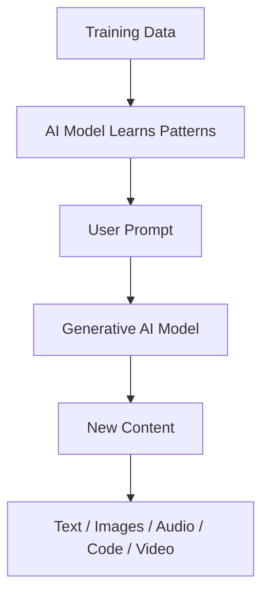

-------------------------------------------------------------------------------------------

## 2. Applications of __Generative AI__ ?

- Creative and Business Writing
- Software development
- Customer Support
- Education
- Designing

--------------------------------------------------------------------------------------------------

## 3. 🤖 What is Agentic AI?

**Agentic AI** is a type of AI that can take up a task or goal from a user and then work toward completing it on its own, with minimal human guidance.

It plans, takes action, adapts to changes, and seeks help only when necessary.

## 🧠 Key Characteristics of Agentic AI

1. **Autonomous** – Can make decisions and take actions independently.
2. **Goal-Oriented** – Works continuously toward achieving a specific objective.
3. **Planning** – Breaks down a high-level goal into smaller tasks.
4. **Reasoning** – Analyses information and makes decisions.
5. **Adaptability** – Modifies plans and actions based on unexpected situations.
6. **Context Awareness** – Understands and uses relevant information from previous interactions and the current environment.

### 🔄 Characteristics Flowchart

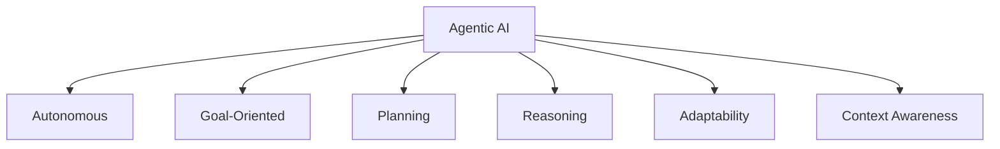

---

# 1. 🔋 Autonomy

**Autonomy** refers to the AI system's ability to make decisions and take actions on its own to achieve a given goal, without needing step-by-step human instructions.

### Key Points

1. Our AI recruiter is autonomous.
2. It is proactive.
3. Autonomy in multiple facets:
   - **Execution**
   - **Decision Making**
   - **Tool Usage**

### 🎛️ Autonomy Can Be Controlled

Autonomy can be controlled using the following mechanisms:

**a. Permission Scope**
- Limits what tools or actions the agent can perform independently.
- Example: The agent can screen candidates but needs approval before rejecting anyone.

**b. Human-in-the-Loop (HITL)**
- Inserts checkpoints where human approval is required before continuing.
- Example: The agent can post a job description only after human approval.

**c. Override Controls**
- Allows users to stop, pause, or change the agent's behaviour at any time.
- Example: Pause the screening command to halt resume processing.

**d. Guardrails / Policies**
- Defines hard rules or ethical boundaries the agent must follow.
- Example: Never schedule interviews on weekends.

### ⚠️ Autonomy Can Be Dangerous

1. The application autonomously sends out job offers with incorrect salaries or terms.
2. The application shortlists candidates by age or nationality, violating anti-discrimination laws.
3. The application spends extra on LinkedIn ads.

### 🔄 Autonomy Control Flowchart

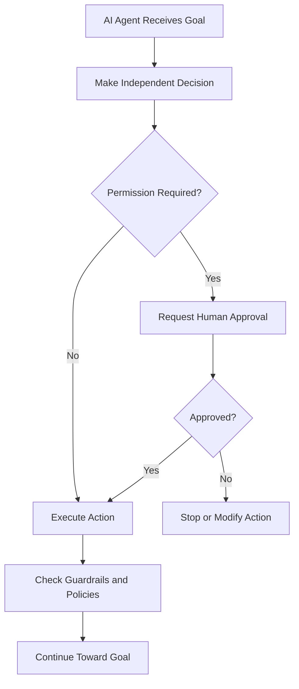

---

# 2. 🎯 Goal-Oriented

Being **goal-oriented** means that the AI system operates with a persistent objective in mind and continuously directs its actions to achieve that objective, rather than just responding to isolated prompts.

### Key Points

1. **Goals act as a compass for Autonomy**
   - Goals guide the agent's independent decisions and actions.

2. **Goals can come with constraints**
   - The agent must achieve the goal while following specified conditions.

3. **Goals are stored in Core Memory**
   - The agent maintains the main objective and its progress.

### 🧪 Example: AI Recruiter Goal

```json
{
  "main_goal": "Hire a backend engineer",
  "constraints": {
    "experience": "2-4 years",
    "remote": true,
    "stack": ["Python", "Django", "Cloud"]
  },
  "status": "active",
  "created_at": "2025-06-27",
  "progress": {
    "JD_created": true,
    "posted_on": ["LinkedIn", "AngelList"],
    "applications_received": 8,
    "interviews_scheduled": 2
  }
}
```

4. **Goals can be altered**
   - The agent can update its objective when the user changes the requirements.

### 🔄 Goal-Oriented Flowchart

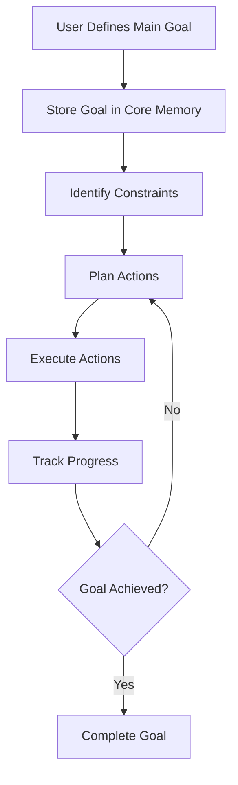

---

# 3. 🗺️ Planning

**Planning** is the agent's ability to break down a high-level goal into a structured sequence of actions or subgoals and decide the best path to achieve the desired outcome.

### Step 1: Generating Multiple Candidate Plans

The agent generates different plans to achieve the same goal.

- **Plan A:** Post JD on LinkedIn, GitHub Jobs, AngelList.
- **Plan B:** Use internal referrals and hiring agencies.

### Step 2: Evaluate Each Plan

The agent evaluates each plan based on:

- **Efficiency:** Which is faster?
- **Tool Availability:** Which tools are available?
- **Cost:** Does it require premium tools?
- **Risk:** Will it fail if we get no applicants?
- **Alignment with Constraints:** Does it satisfy the requirements, such as remote-only and budget?

### Step 3: Select the Best Plan With the Help of:

- **Human-in-the-Loop Input:** Example: "Which of these options do you prefer?"
- **Pre-programmed Policy:** Example: "Favor low-cost channels first."

### 🔄 Planning Flowchart

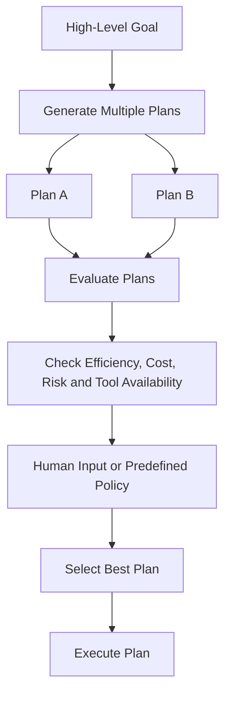

---

# 4. 🧠 Reasoning

**Reasoning** is the cognitive process through which an agentic AI system interprets information, draws conclusions, and makes decisions — both while planning ahead and while executing actions in real time.

## Reasoning During Planning

1. **Goal Decomposition**
   - Breaks down abstract goals into concrete steps.

2. **Tool Selection**
   - Decides which tools will be needed for which steps.

3. **Resource Estimation**
   - Estimates time, dependencies, and risks.

## Reasoning During Execution

1. **Decision-Making**
   - Chooses between available options.
   - Example: Three candidates match, so schedule the two best and reject one.

2. **HITL Handling**
   - Knows when to pause and ask for help.
   - Example: Unsure about the salary range.

3. **Error Handling**
   - Interprets tool/API failures and recovers from them.

### 🔄 Reasoning Flowchart

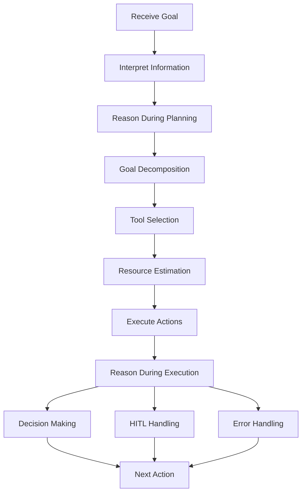

---

# 5. 🔄 Adaptability

**Adaptability** is the agent's ability to modify its plans, strategies, or actions in response to unexpected conditions — all while staying aligned with the goal.

### Examples

1. **Failures (Calendar API)**
   - If the Calendar API fails, the agent can try another available method or retry later.

2. **External Feedback (Less No of Applications)**
   - If fewer applications are received than expected, the agent can change its recruitment strategy.

3. **Changing Goals (Hiring a Freelancer)**
   - If the hiring requirement changes, the agent can modify its plan to hire a freelancer instead.

### 🔄 Adaptability Flowchart

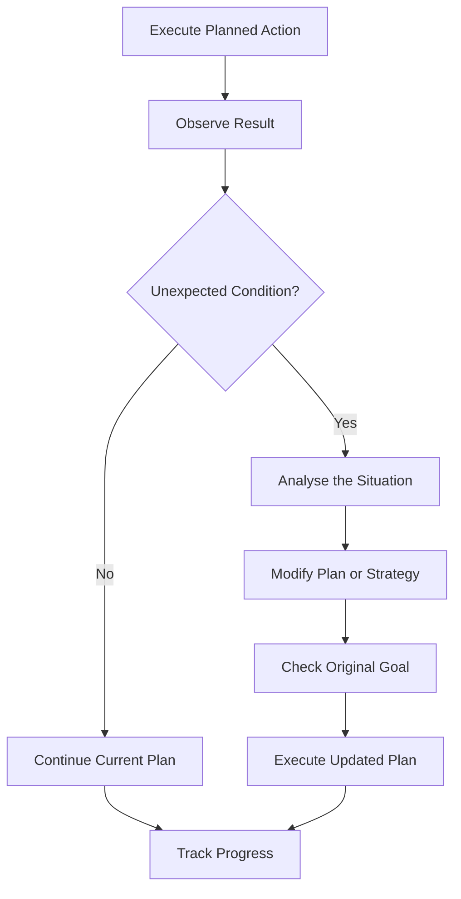

---

# 6. 🧩 Context Awareness

**Context Awareness** is the agent's ability to understand, retain, and utilize relevant information from the ongoing task, past interactions, user preferences, and environmental cues to make better decisions throughout a multi-step process.

## 1. Types of Context

**a. The Original Goal**
- The main objective provided by the user.

**b. Progress Till Now + Interaction History**
- Stores the progress and previous interactions.
- Example: Job description was finalized and posted to LinkedIn and GitHub Jobs.

**c. Environment State**
- Tracks the current external situation.
- Example: Number of applicants so far = 8 or LinkedIn promotion ends in 2 days.

**d. Tool Responses**
- Stores the results returned by external tools.
- Example:
  - Resume Parser → "Candidate B has 3 years Django + AWS experience."
  - Calendar API → "No conflicts at 2 PM Wednesday."

**e. User-Specific Preferences**
- Remembers the user's preferences.
- Example:
  - Prefers remote-first candidates.
  - Likes receiving interview questions in a Google Doc.

**f. Policy or Guardrails**
- Stores rules and restrictions that the agent must follow.
- Example:
  - Do not send an offer without explicit user approval.
  - Never use platforms that require paid ads unless approved.

## 2. Context Awareness Is Implemented Through Memory

Memory helps the agent retain relevant information and use it when making decisions.

## 3. Short-Term Memory

- Stores temporary information required during the current task or conversation.
- Example: Current candidate details, recent tool responses, and interview scheduling status.

## 4. Long-Term Memory

- Stores useful information that may be required across multiple tasks or conversations.
- Example: User preferences, hiring policies, and frequently used recruitment criteria.

### 🔄 Context Awareness Flowchart

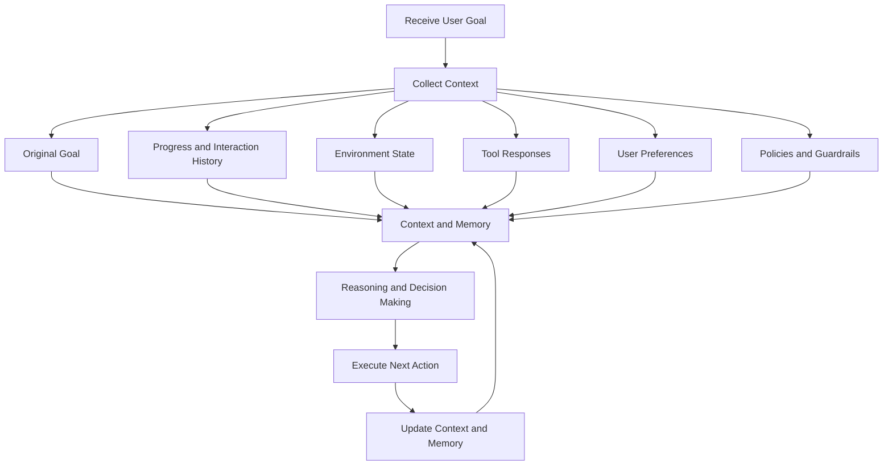

---

# 🌍 Real-World Example: AI-Powered Recruitment Agent

Consider an AI recruitment agent whose goal is to hire a backend engineer.

The agent receives the goal from the user and performs multiple activities independently, while following the user's constraints and approval requirements.

### How Each Characteristic Is Used

| Characteristic | Recruitment Example |
|---|---|
| Autonomy | Screens resumes and shortlists suitable candidates. |
| Goal-Oriented | Focuses on hiring a backend engineer with 2–4 years of experience. |
| Planning | Creates a hiring plan and selects recruitment platforms. |
| Reasoning | Compares candidates based on skills and experience. |
| Adaptability | Changes recruitment strategy if fewer applications are received. |
| Context Awareness | Remembers candidate details, hiring progress, and user preferences. |

### 🔄 Complete Agentic AI Workflow

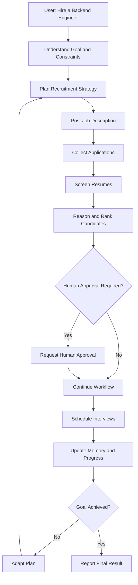

---

# ⭐ Key Takeaways

1. **Autonomy** – The agent can work independently.
2. **Goal-Oriented** – The agent continuously works toward a specific objective.
3. **Planning** – The agent breaks a goal into smaller tasks.
4. **Reasoning** – The agent analyses information and makes decisions.
5. **Adaptability** – The agent modifies its actions when situations change.
6. **Context Awareness** – The agent remembers and uses relevant information.

**In Simple Words:**

Agentic AI is not just about answering questions. It is about understanding a goal, planning the steps, taking actions, learning from the results, adapting to changes, and completing the task with minimal human guidance.

----------------------------------------------------------------------------------------------------------------

## 4. 🧩 Components of Agentic AI

An Agentic AI system consists of five major components:

1. 🧠 Brain
2. 🎼 Orchestrator
3. 🛠️ Tools
4. 💾 Memory
5. 👨‍💼 Supervisor

## 🔄 Components of Agentic AI – Flowchart

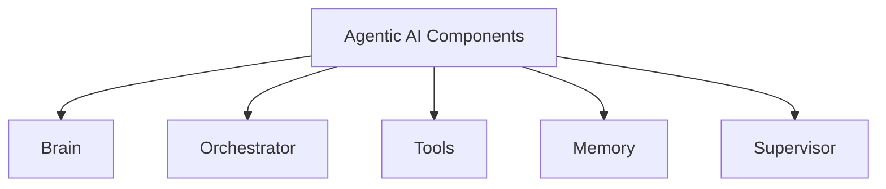

---

# 1. 🧠 Brain

The **Brain** is the intelligence of an AI agent. It understands user instructions, interprets goals, plans actions, reasons about decisions, selects tools, and communicates with humans or other agents.

### Key Responsibilities

| Responsibility | Description |
|---|---|
| Goal Interpretation | Understands user instructions and translates them into objectives. |
| Planning | Breaks down high-level goals into subgoals and ordered steps. |
| Reasoning | Makes decisions, resolves ambiguity, and evaluates trade-offs. |
| Tool Selection | Chooses which tool(s) to use at a given step. |
| Communication | Generates natural language outputs for humans or other agents. |

### 🧪 Example

**User Goal:** Hire a backend engineer.

The Brain:
- Understands the hiring requirements.
- Plans the recruitment process.
- Decides which recruitment platforms to use.
- Selects the appropriate tools.
- Generates responses and communicates the results.

### 🔄 Brain Flowchart

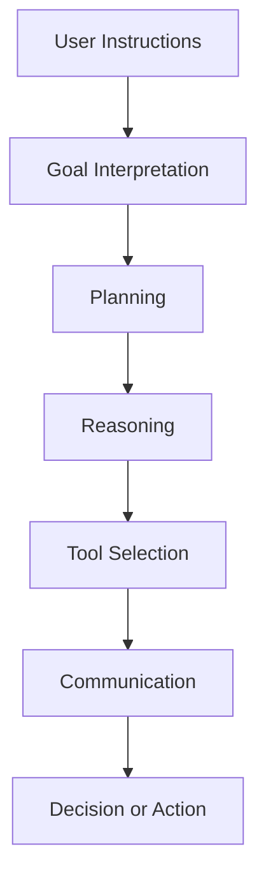

---

# 2. 🎼 Orchestrator

The **Orchestrator** manages and coordinates the overall workflow of an AI agent. It determines the order of actions, manages task execution, handles failures, and ensures that the agent works toward its goal.

### Key Responsibilities

| Responsibility | Description |
|---|---|
| Task Sequencing | Determines the order of actions (step 1 → step 2 → ...). |
| Conditional Routing | Directs flow based on context (e.g., if failure, retry or escalate). |
| Retry Logic | Handles failed tool calls or reasoning attempts with backoff. |
| Looping & Iteration | Repeats steps (e.g., keeps checking job applications until 10 are received). |
| Delegation | Decides whether to hand off work to tools, LLM, or human. |

### 🧪 Example

Suppose the AI recruiter needs to hire a backend engineer.

The Orchestrator manages the following sequence:

1. Create a job description.
2. Post the job description.
3. Collect applications.
4. Screen resumes.
5. Schedule interviews.

If an API fails, it can retry or choose another available path.

### 🔄 Orchestrator Flowchart

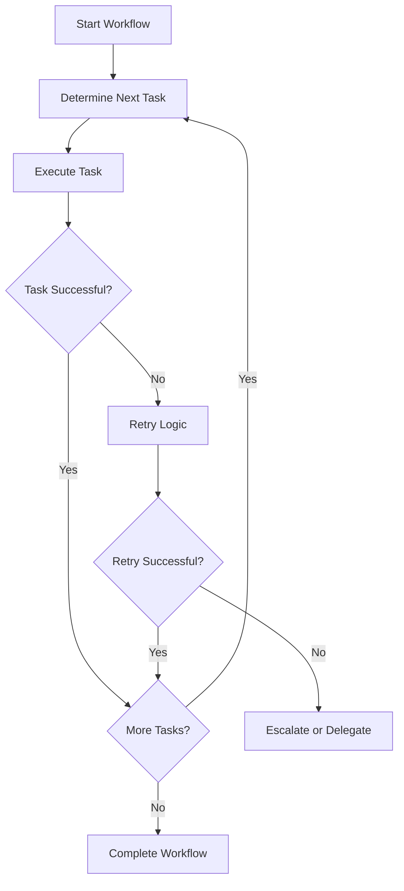

---

# 3. 🛠️ Tools

**Tools** allow an AI agent to interact with external systems and perform real-world actions.

They extend the capabilities of an LLM beyond generating text.

### Key Responsibilities

| Responsibility | Description |
|---|---|
| External Actions | Perform API calls (e.g., post a job, send an email, trigger onboarding). |
| Knowledge Base Access | Retrieve factual or domain-specific information using RAG or search tools to ground responses. |

### 🧪 Examples

- Sending emails using Gmail API.
- Searching the web.
- Accessing databases.
- Posting job descriptions.
- Scheduling meetings using Calendar APIs.
- Retrieving documents using RAG.

### 🔄 Tools Flowchart

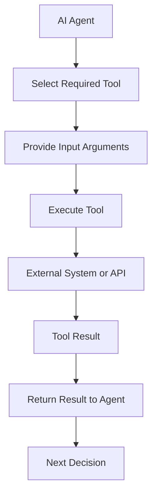

---

# 4. 💾 Memory

**Memory** allows an AI agent to retain information, remember previous interactions, track progress, and use relevant information when making future decisions.

### Key Responsibilities

| Responsibility | Description |
|---|---|
| Short-Term Memory | Maintains the active session's context — recent user messages, tool calls, and immediate decisions. |
| Long-Term Memory | Persists high-level goals, past interactions, user preferences, and decisions across sessions. |
| State Tracking | Monitors progress: what's completed and what's pending (e.g., "JD posted", "Offer sent"). |

### 1. Short-Term Memory

- Stores temporary information required during the current session.
- Maintains recent messages, tool responses, and immediate decisions.

**Example:** The agent remembers that it has already screened five resumes in the current recruitment task.

### 2. Long-Term Memory

- Stores important information across multiple sessions.
- Maintains user preferences, past interactions, goals, and decisions.

**Example:** The agent remembers that the user prefers remote-first candidates.

### 3. State Tracking

- Tracks the current progress of a task.
- Identifies completed and pending activities.

**Example:**
- Job description posted: Yes.
- Applications received: 8.
- Interviews scheduled: 2.
- Offer sent: No.

### 🔄 Memory Flowchart

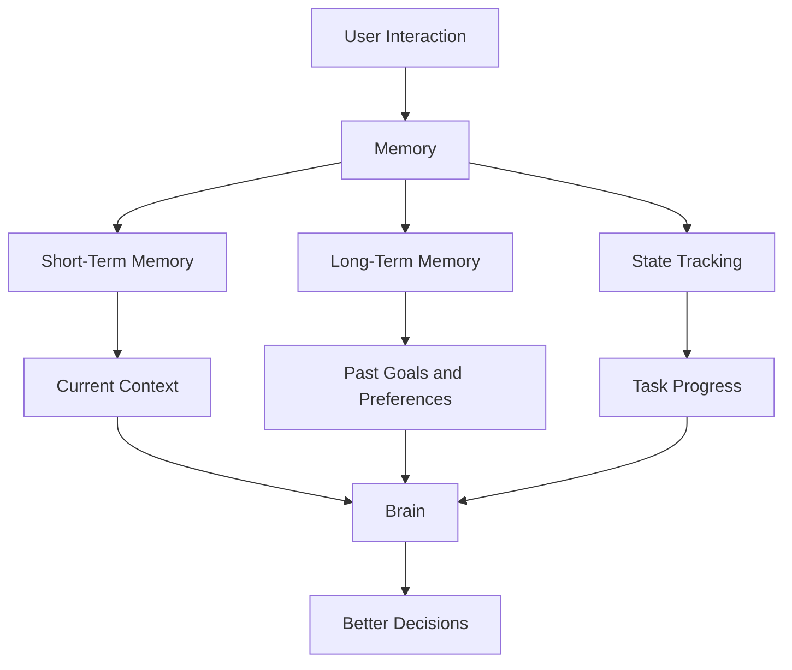

---

# 5. 👨‍💼 Supervisor

The **Supervisor** is responsible for monitoring the AI agent's activities, enforcing safety rules, handling approval requests, and ensuring that the agent operates within the permitted boundaries.

### Key Responsibilities

| Responsibility | Description |
|---|---|
| Approval Requests (HITL) | Agent checks with humans before high-risk actions (e.g., sending offers). |
| Guardrails Enforcement | Blocks unsafe or non-compliant behaviour. |
| Edge Case Escalation | Alerts humans when uncertainty or conflicts arise. |

### 1. Approval Requests (HITL)

- The agent requests human approval before performing sensitive or high-risk actions.
- Example: The agent asks for approval before sending a job offer.

### 2. Guardrails Enforcement

- Ensures that the agent follows predefined rules and policies.
- Blocks actions that violate safety or business requirements.
- Example: Prevents the agent from rejecting candidates based on nationality.

### 3. Edge Case Escalation

- Transfers the issue to a human when uncertainty or conflicts arise.
- Example: If two candidates have similar qualifications and the agent cannot confidently choose, it asks a human to decide.

### 🔄 Supervisor Flowchart

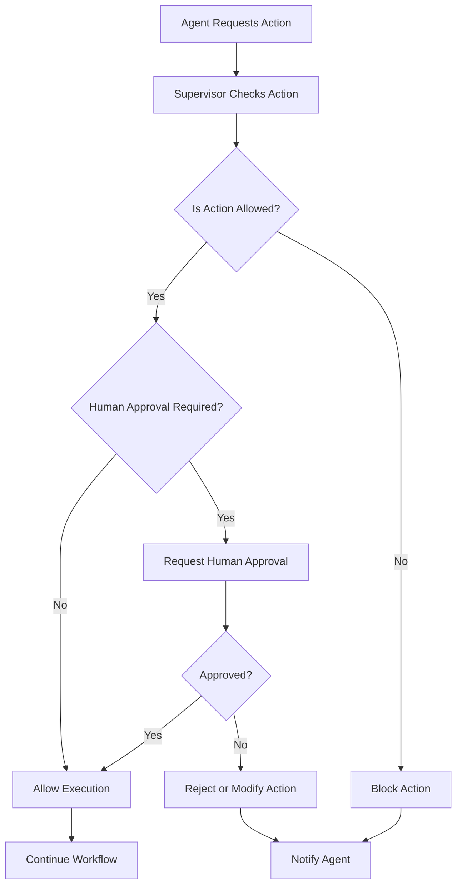

---

# 🌍 Real-World Example: AI-Powered Recruitment Agent

Consider an AI recruitment agent whose goal is to hire a backend engineer.

Each component performs a specific responsibility:

| Component | Real-World Responsibility |
|---|---|
| 🧠 Brain | Understands the hiring requirements, plans recruitment, and selects appropriate tools. |
| 🎼 Orchestrator | Coordinates the workflow, determines task order, handles retries, and manages execution. |
| 🛠️ Tools | Posts job descriptions, searches candidates, reads resumes, and schedules interviews. |
| 💾 Memory | Remembers candidate details, user preferences, and recruitment progress. |
| 👨‍💼 Supervisor | Checks policies and requests human approval before sending job offers. |

### 🔄 Complete Workflow

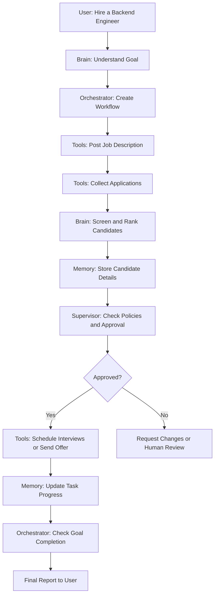

---

# ⭐ Key Takeaways

| Component | Main Purpose |
|---|---|
| Brain | Thinks, reasons, plans, and makes decisions. |
| Orchestrator | Coordinates and manages the workflow. |
| Tools | Perform external actions and access information. |
| Memory | Stores information and tracks progress. |
| Supervisor | Monitors actions, enforces policies, and handles approvals. |

### 🧠 Remember in Simple Words

- **Brain:** Thinks.
- **Orchestrator:** Manages the workflow.
- **Tools:** Performs actions.
- **Memory:** Remembers information.
- **Supervisor:** Monitors and controls actions.

**Final Understanding:** All five components work together to help an Agentic AI system understand a goal, plan tasks, execute actions, remember information, and operate safely with minimal human guidance.

-----------------------------------------------------------------------------------------------------------

## 5. 🔗 What is LangChain?

**LangChain** is an open-source library designed to simplify the process of building LLM-based applications.

It provides modular building blocks that let you create sophisticated LLM-based workflows with ease.

## 🧩 Components of LangChain

LangChain consists of multiple components:

1. **Models**
   - Gives us a unified interface to interact with various LLM providers.
   - Examples: OpenAI, Google Gemini, Anthropic, Hugging Face.

2. **Prompts**
   - Helps us engineer prompts.
   - Allows us to provide instructions and context to LLMs.

3. **Retrievers**
   - Helps us fetch relevant documents from a vector store.
   - Commonly used in RAG applications.

4. **Chains**
   - Connect multiple components together to create structured workflows.
   - The biggest offering of LangChain is Chains.

## 🔄 LangChain Workflow

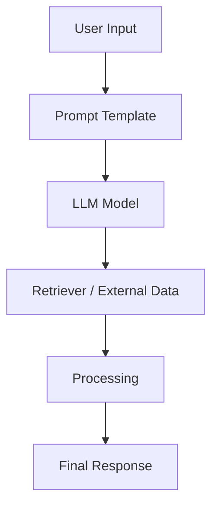

## 🚀 What Can You Do With LangChain?

1. **Simple Conversational Workflows**
   - Chatbots
   - Text summarizers

2. **Multi-Step Workflows**
   - Connect multiple tasks and execute them in sequence.

3. **RAG Applications**
   - Retrieve relevant information from external documents and generate answers.

4. **Basic-Level Agents**
   - Build agents that can reason, select tools, and perform actions.

---

# ⚙️ Challenges in Building AI Workflows

When building complex AI applications, we face several challenges. LangChain and workflow orchestration frameworks help us organize and manage these workflows.

## 1. 🔀 Challenge #1 – Control Flow Complexity

Control Flow Complexity refers to the difficulty of managing the execution order of tasks in a workflow.

A complex workflow may contain:

1. **Conditional Branches**
   - Execute different actions based on conditions.
   - Example: If a job description is approved, post it; otherwise, modify it.

2. **Loops**
   - Repeat actions until a particular condition is satisfied.
   - Example: Keep checking job applications until at least 10 applications are received.

3. **Jumps**
   - Move execution from one step to another based on a condition or event.
   - Example: If an API fails, jump to the retry step.

### 🧪 Real-World Example: Automated Hiring Workflow

An automated hiring workflow performs the following activities:

- Receive a hiring request.
- Create a job description.
- Get approval.
- Post the job.
- Wait for applications.
- Monitor applications.
- Shortlist candidates.
- Schedule interviews.
- Conduct interviews.
- Send offer letters.
- Complete onboarding.

### 🔄 Automated Hiring Workflow

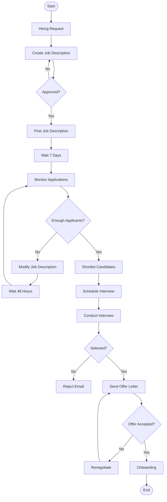

### ⭐ Key Takeaway

Control Flow Complexity becomes difficult when workflows contain multiple conditions, loops, retries, and jumps.

---

## 2. 💾 Challenge #2 – Handling State

**State** refers to the information that an AI workflow needs to maintain throughout its execution.

In a multi-step workflow, the system must remember:
- What is the main goal?
- Which tasks are completed?
- Which tasks are pending?
- What are the results of previous actions?
- What should happen next?

### 🧪 Example: Recruitment Workflow State

```python
state = {
    "goal": "Hire a backend software engineer",
    "jd": "",  # Job description text
    "jd_approved": False,
    "jd_posted": False,
    "min_applicants": 5,
    "num_applications": 0,
    "shortlisted_candidates": {
        # "candidate_id": {
        #     "name": "...",
        #     "score": "...",
        #     "status": "..."
        # }
    },
    "interview_questions": [],
    "offer_status": {
        "sent": False,
        "accepted": False,
        "renegotiated": False
    },
    "onboarding_status": {
        "completed": False,
        "start_date": None,
        "employee_id": None
    }
}
```

### 📌 Important Points

1. **State Initialization**
   - Create the initial state before starting the workflow.

2. **State Updates**
   - Update the state whenever an action is completed.

3. **State Persistence**
   - Store the state so that the workflow can resume later.

4. **State Sharing**
   - Make relevant information available to different workflow steps.

5. **State Tracking**
   - Keep track of completed and pending tasks.

### 🔄 State Handling Flowchart

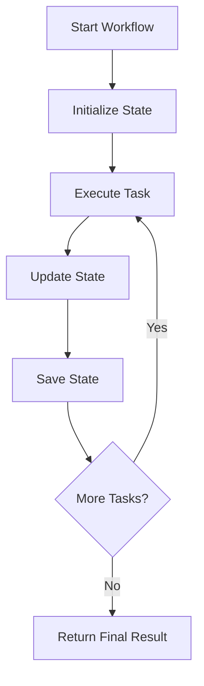

### ⭐ Key Takeaway

State handling ensures that an AI workflow remembers its progress and does not lose important information between steps.

---

## 3. ⚡ Challenge #3 – Event-Driven Execution

**Event-Driven Execution** is a workflow execution approach in which actions are triggered automatically when a specific event occurs.

Instead of continuously checking for changes, the workflow responds to events.

### 📌 Important Points

1. **Event Trigger**
   - Starts a workflow when a particular event occurs.

2. **Event Detection**
   - Identifies the event that has occurred.

3. **Event Handling**
   - Executes the appropriate action based on the event.

4. **Asynchronous Execution**
   - Allows tasks to run without blocking other operations.

### 🧪 Examples

- When a user submits a form, generate a response.
- When a new job application arrives, process the resume.
- When an interview is scheduled, send a confirmation email.
- When payment is completed, trigger order processing.

### 🔄 Event-Driven Workflow

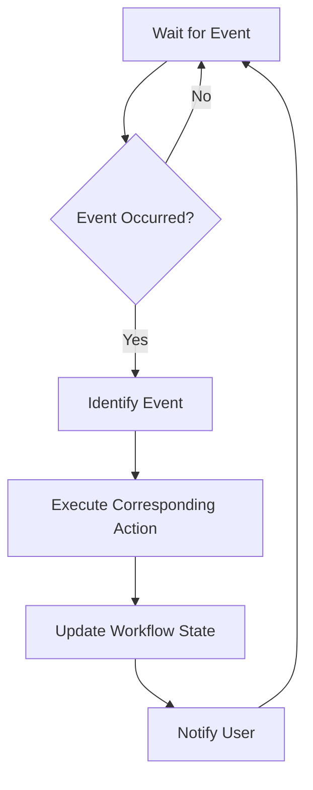

### ⭐ Key Takeaway

Event-driven execution allows workflows to respond automatically to external events, user actions, and system updates.

---

## 4. 🛡️ Challenge #4 – Fault Tolerance

**Fault Tolerance** is the ability of a workflow to continue operating or recover when errors, failures, or unexpected situations occur.

A reliable AI workflow should not completely fail because one task or API call fails.

### 📌 Important Points

1. **Retry Mechanism**
   - Retry failed operations automatically.

2. **Error Handling**
   - Identify and handle errors without crashing the entire workflow.

3. **Fallback Mechanism**
   - Use an alternative tool or approach when the primary one fails.

4. **Timeout Handling**
   - Stop waiting when an operation takes too long.

5. **Checkpointing**
   - Save workflow progress so execution can resume from the last successful step.

6. **Logging**
   - Record errors and failures for debugging.

### 🧪 Example

Suppose an AI recruitment agent uses a Calendar API to schedule interviews.

If the Calendar API fails:
- The agent identifies the failure.
- It retries the API call.
- If the retry fails, it can use an alternative scheduling method.
- It informs the user if the operation still cannot be completed.

### 🔄 Fault Tolerance Flowchart

```mermaid
flowchart TD
    A[Execute Task] --> B{Successful?}
    B -->|Yes| C[Save Progress]
    B -->|No| D[Identify Error]
    D --> E[Retry Operation]
    E --> F{Retry Successful?}
    F -->|Yes| C
    F -->|No| G[Use Fallback]
    G --> H{Fallback Successful?}
    H -->|Yes| C
    H -->|No| I[Log Error and Notify User]
```

### ⭐ Key Takeaway

Fault tolerance makes AI workflows more reliable by handling failures, retrying operations, and recovering from errors.

---

## 5. 👨‍💼 Challenge #5 – Human-in-the-Loop (HITL)

**Human-in-the-Loop (HITL)** is an approach in which a human is involved in the AI workflow to review, approve, reject, or modify important decisions.

The AI agent performs tasks independently but requests human assistance whenever necessary.

### 📌 Important Points

1. **Human Approval**
   - Requires approval before performing important actions.

2. **Human Feedback**
   - Allows humans to provide corrections and suggestions.

3. **Decision Review**
   - Allows humans to review AI-generated decisions.

4. **Safety and Control**
   - Prevents the agent from performing unauthorized or risky actions.

5. **Escalation**
   - Transfers uncertain or sensitive situations to a human.

### 🧪 Example

An AI recruitment agent:
- Screens resumes automatically.
- Shortlists suitable candidates.
- Requests human approval before sending an offer letter.
- Sends the offer only after approval.

### 🔄 Human-in-the-Loop Flowchart

```mermaid
flowchart TD
    A[AI Agent Performs Task] --> B[Generate Decision]
    B --> C{Human Approval Required?}
    C -->|No| D[Continue Workflow]
    C -->|Yes| E[Send Approval Request]
    E --> F[Human Reviews Decision]
    F --> G{Approved?}
    G -->|Yes| D
    G -->|No| H[Modify or Reject Decision]
    H --> I[Update Workflow]
    I --> B
    D --> J[Complete Task]
```

### ⭐ Key Takeaway

HITL combines AI automation with human judgment to improve safety, accuracy, and control.

---

## 6. 🔗 Challenge #6 – Nested Workflows

**Nested Workflows** refer to workflows that contain other smaller workflows inside them.

A large task can be divided into multiple independent or reusable sub-workflows.

### 📌 Important Points

1. **Workflow Decomposition**
   - Break a large workflow into smaller workflows.

2. **Reusability**
   - Reuse existing workflows in different applications.

3. **Modularity**
   - Each sub-workflow handles a specific responsibility.

4. **Maintainability**
   - Smaller workflows are easier to test, debug, and modify.

5. **Coordination**
   - The main workflow coordinates the execution of sub-workflows.

### 🧪 Example: Recruitment Workflow

A complete recruitment workflow can contain:

- **Job Description Workflow**
  - Generate job description.
  - Review job description.
  - Get approval.

- **Resume Screening Workflow**
  - Read resumes.
  - Extract candidate details.
  - Rank candidates.

- **Interview Workflow**
  - Generate interview questions.
  - Schedule interviews.
  - Send notifications.

- **Onboarding Workflow**
  - Generate offer letter.
  - Complete documentation.
  - Create employee records.

### 🔄 Nested Workflow Flowchart

```mermaid
flowchart TD
    A[Main Recruitment Workflow] --> B[Job Description Workflow]
    A --> C[Resume Screening Workflow]
    A --> D[Interview Workflow]
    A --> E[Onboarding Workflow]

    B --> F[Approved Job Description]
    C --> G[Shortlisted Candidates]
    D --> H[Interview Results]
    E --> I[Employee Onboarded]

    F --> J[Main Workflow]
    G --> J
    H --> J
    I --> J
```

### ⭐ Key Takeaway

Nested workflows help organize complex AI applications into smaller, reusable, and manageable workflows.

---

## 7. 📊 Challenge #7 – Observability

**Observability** refers to how easily you can monitor, debug, and understand what your workflow is doing at runtime.

It helps developers understand what happened during workflow execution and identify problems.

### 📌 Important Points

1. **Logging**
   - Records events, actions, errors, and execution details.

2. **Monitoring**
   - Tracks workflow execution and system performance.

3. **Tracing**
   - Tracks the complete execution path of a workflow across multiple steps.

4. **Error Tracking**
   - Identifies failed operations and their causes.

5. **Performance Measurement**
   - Measures execution time, latency, and resource usage.

6. **Debugging**
   - Helps developers identify and fix problems.

### 🧪 Example

Suppose an AI recruitment workflow fails while scheduling an interview.

Observability helps us identify:
- Which workflow step failed.
- Which API caused the failure.
- How long the operation took.
- What input was provided.
- What error was returned.

### 🔄 Observability Flowchart

```mermaid
flowchart TD
    A[Workflow Execution] --> B[Collect Execution Data]
    B --> C[Logs]
    B --> D[Metrics]
    B --> E[Traces]
    C --> F[Observability System]
    D --> F
    E --> F
    F --> G[Monitor Workflow]
    G --> H[Identify Errors]
    H --> I[Debug and Improve Workflow]
```

### ⭐ Key Takeaway

Observability helps developers monitor, understand, debug, and improve AI workflows.

---

# 🌍 Real-World Example – Automated Hiring Workflow

Consider an AI-powered recruitment system designed to hire a backend software engineer.

The system uses LangChain-based components and workflow orchestration to automate the recruitment process.

### How the Challenges Are Handled

| Challenge | Recruitment Example |
|---|---|
| Control Flow Complexity | Handles approval conditions, application loops, and interview decisions. |
| Handling State | Stores job details, candidate information, and recruitment progress. |
| Event-Driven Execution | Processes a resume whenever a new application arrives. |
| Fault Tolerance | Retries failed API calls and handles scheduling errors. |
| Human-in-the-Loop | Requests approval before sending an offer letter. |
| Nested Workflows | Separates job creation, resume screening, interviews, and onboarding. |
| Observability | Tracks workflow execution, errors, and performance. |

### 🔄 Complete Recruitment Workflow

```mermaid
flowchart TD
    A([Start]) --> B[Receive Hiring Request]
    B --> C[Generate Job Description]
    C --> D{Human Approval?}
    D -->|No| C
    D -->|Yes| E[Post Job]
    E --> F[Wait for Applications]
    F --> G[Process New Applications]
    G --> H[Screen Resumes]
    H --> I[Update State]
    I --> J{Candidate Qualified?}
    J -->|No| K[Reject Candidate]
    J -->|Yes| L[Schedule Interview]
    L --> M{Scheduling Successful?}
    M -->|No| N[Retry Scheduling]
    N --> L
    M -->|Yes| O[Conduct Interview]
    O --> P[Human Reviews Candidate]
    P --> Q{Selected?}
    Q -->|No| K
    Q -->|Yes| R[Generate Offer Letter]
    R --> S{Offer Approved?}
    S -->|No| T[Request Changes]
    T --> R
    S -->|Yes| U[Send Offer]
    U --> V[Onboarding]
    V --> W([End])
```

---

# ⭐ Final Summary – Seven Challenges

| No. | Challenge | Main Purpose |
|---|---|---|
| 1 | Control Flow Complexity | Manage conditions, loops, and jumps. |
| 2 | Handling State | Maintain information and workflow progress. |
| 3 | Event-Driven Execution | Trigger actions when events occur. |
| 4 | Fault Tolerance | Handle failures and recover from errors. |
| 5 | Human-in-the-Loop | Include human approval and feedback. |
| 6 | Nested Workflows | Divide complex workflows into smaller workflows. |
| 7 | Observability | Monitor, debug, and understand workflow execution. |

## 🧠 Remember in Simple Words

- **Control Flow Complexity:** What should happen next?
- **Handling State:** What has happened so far?
- **Event-Driven Execution:** When should an action start?
- **Fault Tolerance:** What happens if something fails?
- **Human-in-the-Loop:** When should a human intervene?
- **Nested Workflows:** How can we divide a large task?
- **Observability:** How can we monitor and debug the workflow?

----------------------------------------------------------------------------------------------------

## 5. 🦜 What is LangGraph?

**LangGraph** is an orchestration framework that enables you to build **stateful, multi-step, and event-driven workflows** using Large Language Models (LLMs).

It is ideal for designing both **single-agent and multi-agent Agentic AI applications**.

Think of LangGraph as a **flowchart engine for LLMs**:

- **Nodes:** Define the steps or tasks to be performed.
- **Edges:** Define how different steps are connected.
- **State:** Maintains information throughout the workflow.
- **Transitions:** Define the logic that controls how the workflow moves between steps.

LangGraph takes care of:

1. **State Management** – Maintains information throughout workflow execution.
2. **Conditional Branching** – Executes different paths based on conditions.
3. **Looping** – Repeats steps until a particular condition is satisfied.
4. **Pausing and Resuming** – Allows workflows to pause and continue later.
5. **Fault Recovery** – Helps workflows recover from failures.

These features are essential for building robust, production-grade AI systems.

## 🔄 How LangGraph Works

```mermaid
flowchart TD
    A[Start] --> B[Node 1: Receive User Query]
    B --> C[Node 2: Process Query]
    C --> D{Conditional Edge}
    D -->|Condition 1| E[Node 3: Execute Action]
    D -->|Condition 2| F[Node 4: Call Tool]
    E --> G[Update State]
    F --> G
    G --> H{Continue?}
    H -->|Yes| C
    H -->|No| I[Final Response]
```

## 🧩 Important Components of LangGraph

| Component | Description |
|---|---|
| Nodes | Individual steps or tasks in a workflow. |
| Edges | Connections between nodes that define execution flow. |
| State | Stores and maintains information throughout the workflow. |
| Conditional Edges | Decide which path the workflow should follow. |
| Checkpointing | Saves workflow state so execution can be resumed. |

---

# 2. ⚖️ When to Use What? – LangChain vs LangGraph

Both LangChain and LangGraph are useful for building LLM-based applications, but they are designed for different workflow requirements.

## 🔗 When to Use LangChain?

Use **LangChain** when you're building simple, linear workflows.

### Examples

- Prompt chains
- Text summarizers
- Basic retrieval systems
- Simple conversational workflows

### Characteristics

- Simple execution flow.
- Suitable for sequential tasks.
- Connects LLMs with prompts, retrievers, and tools.
- Best for straightforward workflows.

## 🦜 When to Use LangGraph?

Use **LangGraph** when your use case involves complex, non-linear workflows.

### Examples

1. **Conditional Paths**
   - Execute different steps based on conditions.

2. **Loops**
   - Repeat tasks until a particular condition is satisfied.

3. **Human-in-the-Loop Steps**
   - Pause execution and request human approval.

4. **Multi-Agent Coordination**
   - Coordinate multiple AI agents working together.

5. **Asynchronous or Event-Driven Execution**
   - Execute tasks based on events and external triggers.

### Characteristics

- Supports stateful workflows.
- Handles complex execution paths.
- Supports conditional branching and looping.
- Allows workflows to pause and resume.
- Suitable for single-agent and multi-agent systems.

## 🔄 LangChain vs LangGraph Flowchart

```mermaid
flowchart TD
    A[LLM Application] --> B{Workflow Complexity?}
    B -->|Simple and Linear| C[LangChain]
    B -->|Complex and Non-Linear| D[LangGraph]

    C --> E[Prompt Chains]
    C --> F[Summarizers]
    C --> G[Basic Retrieval Systems]

    D --> H[Conditional Paths]
    D --> I[Loops]
    D --> J[Human-in-the-Loop]
    D --> K[Multi-Agent Coordination]
    D --> L[Event-Driven Execution]
```

## 📊 Comparison Table

| Feature | LangChain | LangGraph |
|---|---|---|
| Main Purpose | Build LLM-based applications and workflows. | Orchestrate complex, stateful workflows. |
| Workflow Type | Simple and linear workflows. | Complex and non-linear workflows. |
| State Management | Supports state through application components and memory integrations. | Provides explicit shared workflow state. |
| Conditional Branching | Available through workflow components. | Supports graph-based conditional routing. |
| Looping | Can be implemented using chains and other components. | Supports cycles and iterative execution. |
| Human-in-the-Loop | Can be integrated into applications. | Supports pausing and resuming workflows for human interaction. |
| Multi-Agent Systems | Provides agent-building components. | Supports coordination of multiple agents. |
| Use Cases | Chatbots, summarizers, and basic RAG. | Complex agents, multi-agent systems, and advanced workflows. |

---

# 🌍 Real-World Examples

## Example 1: LangChain – Text Summarizer

Suppose a user provides a document and wants a summary.

```mermaid
flowchart TD
    A[User Uploads Document] --> B[Document Loader]
    B --> C[Text Splitter]
    C --> D[Prompt Template]
    D --> E[LLM]
    E --> F[Generate Summary]
    F --> G[Return Result]
```

This is a simple, sequential workflow. LangChain is suitable for building it.

## Example 2: LangGraph – AI Recruitment Agent

Suppose an AI agent needs to hire a backend engineer.

```mermaid
flowchart TD
    A[Receive Hiring Request] --> B[Create Job Description]
    B --> C{Approved?}
    C -->|No| D[Modify Job Description]
    D --> B
    C -->|Yes| E[Post Job]
    E --> F[Collect Applications]
    F --> G[Screen Resumes]
    G --> H{Candidate Qualified?}
    H -->|No| F
    H -->|Yes| I[Schedule Interview]
    I --> J[Human Review]
    J --> K{Selected?}
    K -->|No| F
    K -->|Yes| L[Generate Offer]
    L --> M[Complete Onboarding]
    M --> N[End]
```

This workflow involves conditions, loops, state management, and human approval. LangGraph is suitable for orchestrating it.

---

# ⭐ Key Takeaways

- **LangChain:** Best suited for building simple LLM-based applications and linear workflows.
- **LangGraph:** Best suited for building complex, stateful, and non-linear AI workflows.
- LangGraph uses nodes, edges, and state to manage workflow execution.
- LangGraph supports conditional branching, looping, pausing, resuming, and fault recovery.
- Both frameworks can be used together to build powerful Agentic AI applications.

## 🧠 Remember in Simple Words

- **LangChain:** Connects LLM components to build applications.
- **LangGraph:** Controls how an AI workflow executes, makes decisions, and moves between steps.

------------------------------------------------------------------------------------------------------------------

## 6. 🦜 LangGraph – Concepts and Workflow Patterns

## 1. What is LangGraph?

**LangGraph** is an orchestration framework for building **intelligent, stateful, and multi-step LLM workflows**.

It enables advanced features like:

- **Parallelism** – Execute multiple tasks simultaneously.
- **Loops** – Repeat tasks until a particular condition is satisfied.
- **Branching** – Choose different execution paths based on conditions.
- **Memory** – Maintain information throughout workflow execution.
- **Resumability** – Pause and resume workflows from where they stopped.

These features make LangGraph ideal for building Agentic AI and production-grade AI applications.

It models your logic as a **graph of nodes (tasks) and edges (routing)** instead of a linear chain.

### 🔑 Important Concepts

1. **Nodes:** Individual functions or tasks that perform specific operations.
2. **Edges:** Connections that determine which node executes next.
3. **State:** Shared memory that stores information and passes it between nodes.
4. **Conditional Edges:** Route execution based on conditions.
5. **Reducers:** Define how updates from nodes are applied to shared state.

---

# 2. What are LLM Workflows?

LLM workflows are a step-by-step process using which we can build complex LLM applications.

### Important Points

1. Each step in a workflow performs a distinct task — such as prompting, reasoning, tool calling, memory access, or decision-making.
2. Workflows can be linear, parallel, branched, or looped.
3. They allow complex behaviours like:
   - Retries
   - Multi-agent communication
   - Tool-augmented reasoning
   - Conditional execution

## 🔄 Types of LLM Workflows

### 2.1 Prompt Chaining

**Prompt Chaining** is a workflow pattern in which the output of one LLM call becomes the input for the next LLM call.

Each step performs a specific task, and the workflow executes sequentially.

### Flowchart

```mermaid
flowchart TD
    A[Input] --> B[LLM Call 1]
    B --> C[Output 1]
    C --> D{Gate}
    D -->|Pass| E[LLM Call 2]
    D -->|Fail| F[Exit]
    E --> G[Output 2]
    G --> H[LLM Call 3]
    H --> I[Final Output]
```

### How It Works

1. The user provides an input.
2. LLM Call 1 processes the input.
3. Its output is passed to the next step.
4. A gate checks whether the output satisfies the required condition.
5. If the condition passes, the workflow continues.
6. If the condition fails, the workflow exits or follows an alternative path.

### Example

Generating an article:

- LLM Call 1: Generate an article outline.
- LLM Call 2: Write the article using the outline.
- LLM Call 3: Correct grammar and improve readability.

### Real-World Example

A content-generation application:

```text
User Topic
    ↓
Generate Outline
    ↓
Write Content
    ↓
Check Grammar
    ↓
Final Article
```

---

### 2.2 Routing

**Routing** is a workflow pattern in which an LLM or routing function analyzes the input and directs it to the appropriate task or model.

Different inputs can follow different execution paths.

### Flowchart

```mermaid
flowchart TD
    A[Input] --> B[LLM Call Router]
    B --> C[LLM Call 1]
    B --> D[LLM Call 2]
    B --> E[LLM Call 3]
    C --> F[Output]
    D --> F
    E --> F
```

### How It Works

1. Receive the user's input.
2. Analyze and classify the input.
3. Select the appropriate LLM or processing path.
4. Execute the selected task.
5. Return the final output.

### Example

An AI customer-support system:

- Billing-related questions → Billing LLM.
- Technical questions → Technical Support LLM.
- General questions → General-purpose LLM.

### Real-World Example

A customer asks, "Why was I charged twice?"

The router identifies this as a billing question and sends it to the billing-support workflow.

---

### 2.3 Parallelization

**Parallelization** is a workflow pattern in which multiple tasks are executed simultaneously rather than one after another.

It is useful when tasks are independent and can be performed at the same time.

### Flowchart

```mermaid
flowchart TD
    A[Input] --> B[LLM Call 1]
    A --> C[LLM Call 2]
    A --> D[LLM Call 3]

    B --> E[Aggregator]
    C --> E
    D --> E

    E --> F[Final Output]
```

### How It Works

1. Receive the input.
2. Divide the work into independent subtasks.
3. Execute all subtasks simultaneously.
4. Collect their outputs.
5. Combine the outputs using an aggregator.
6. Generate the final result.

### Example

YouTube content analysis:

- LLM Call 1: Analyze the video's introduction.
- LLM Call 2: Analyze the main content.
- LLM Call 3: Analyze the conclusion.
- Aggregator: Combine all results.

### Real-World Example

A product-review application can perform these tasks simultaneously:

- Analyze product quality.
- Analyze customer reviews.
- Analyze product pricing.

Finally, all results are combined to generate a product recommendation.

---

### 2.4 Orchestrator-Workers

**Orchestrator-Workers** is a workflow pattern in which an orchestrator divides a complex task into smaller subtasks and assigns them to different workers.

The workers execute their assigned tasks, and a synthesizer combines their outputs.

### Flowchart

```mermaid
flowchart TD
    A[Input] --> B[Orchestrator]

    B --> C[LLM Worker 1]
    B --> D[LLM Worker 2]
    B --> E[LLM Worker 3]

    C --> F[Synthesizer]
    D --> F
    E --> F

    F --> G[Final Output]
```

### How It Works

1. Receive a complex task.
2. The orchestrator analyzes the task.
3. Divide the task into smaller subtasks.
4. Assign subtasks to different workers.
5. Workers execute their assigned tasks.
6. The synthesizer collects and combines their outputs.
7. Return the final result.

### Example

Researching a company:

- Worker 1: Research company history.
- Worker 2: Research products and services.
- Worker 3: Research competitors.
- Synthesizer: Combine all findings into a report.

### Real-World Example

An AI research assistant can divide a research topic into multiple areas and assign each area to a specialized worker.

---

### 2.5 Evaluator-Optimizer

**Evaluator-Optimizer** is a workflow pattern in which one LLM generates an output and another LLM evaluates it.

If the output is rejected, feedback is sent back to the generator to improve the result.

This process continues until the output satisfies the required conditions.

### Flowchart

```mermaid
flowchart TD
    A[Input] --> B[LLM Call Generator]
    B --> C[Generated Solution]
    C --> D[LLM Call Evaluator]
    D --> E{Accepted?}

    E -->|Yes| F[Final Output]
    E -->|No| G[Feedback]
    G --> B
```

### How It Works

1. Receive the input.
2. The generator produces an initial solution.
3. The evaluator checks the solution.
4. If accepted, return the final output.
5. If rejected, generate feedback.
6. Send feedback to the generator.
7. Repeat the process until the solution is accepted.

### Example

Essay writing:

- Generator: Writes an essay.
- Evaluator: Checks grammar, language, and clarity.
- Feedback: Identifies mistakes and suggests improvements.
- Generator: Rewrites the essay.

### Real-World Example

An AI code-review system:

1. An LLM generates code.
2. Another LLM reviews the code.
3. It identifies bugs and performance issues.
4. Feedback is sent to the code generator.
5. The generator improves the code.

---

# 3. Graphs, Nodes and Edges

A **Graph** is a collection of nodes and edges that represents the execution flow of a workflow.

In LangGraph, the workflow is represented as a graph rather than a simple linear chain.

## 3.1 Nodes

**Nodes** are individual functions or tasks that perform specific operations in a workflow.

Examples:

- GenerateTopic
- CollectEssay
- EvaluateEssay
- AggregateResults
- GiveFeedback
- ShowSuccess

## 3.2 Edges

**Edges** define the connections between nodes and determine which node executes next.

Types of edges:

1. **Normal Edges:** Connect one node to another in a fixed sequence.
2. **Conditional Edges:** Select the next node based on a condition.
3. **Entry Point:** Defines where workflow execution begins.
4. **End Point:** Defines where workflow execution finishes.

## Example: Essay Evaluation System

The system generates an essay topic, collects the student's submission, and evaluates it in parallel on:

- Depth of Analysis
- Language Quality
- Clarity of Thought

Based on the combined score, it either provides feedback for improvement or approves the essay.

### Workflow Steps

**1. GenerateTopic**

- System generates a relevant UPSC-style essay topic.
- Presents it to the student.

**2. CollectEssay**

- Student writes and submits the essay based on the generated topic.

**3. EvaluateEssay (Parallel Evaluation Block)**

Three evaluation tasks run in parallel:

- **EvaluateDepth:** Analyzes depth of analysis, argument strength, and critical thinking.
- **EvaluateLanguage:** Checks grammar, vocabulary, fluency, and tone.
- **EvaluateClarity:** Assesses coherence, logical flow, and clarity of thought.

**4. AggregateResults**

- Combines the three scores.
- Generates a total score (e.g., out of 15).

**5. ConditionalRouting**

Based on the total score:

- If the score meets the threshold → Go to ShowSuccess.
- If the score is below the threshold → Go to GiveFeedback.

**6. GiveFeedback**

- Provides targeted suggestions for improvement in weak areas.

**7. CollectRevision (Optional Loop)**

- Student resubmits the revised essay.
- Loop back to EvaluateEssay.

**8. ShowSuccess**

- Congratulates the student and ends the flow.

### Flowchart

```mermaid
flowchart TD
    A[Generate Topic] --> B[Write Essay]

    B --> C[Evaluate Depth]
    B --> D[Evaluate Language]
    B --> E[Evaluate Clarity]

    C --> F[Aggregate Results]
    D --> F
    E --> F

    F --> G{Final Evaluation}

    G -->|Score Meets Threshold| H[Show Success]
    G -->|Score Below Threshold| I[Give Feedback]

    I --> J[Collect Revision]
    J --> B

    H --> K[End]
```

---

# 4. State in LangGraph

**State** in LangGraph is the shared memory that flows through your workflow.

It holds all the data being passed between nodes as your graph runs.

### Important Points

1. State stores information required by different nodes.
2. Nodes can read the current state.
3. Nodes can return updates to the state.
4. Updated information is available to subsequent nodes.
5. State helps maintain context throughout workflow execution.

### Example

Consider an essay-evaluation workflow.

The state may contain:

```python
state = {
    "topic": "Importance of Artificial Intelligence",
    "essay": "AI is transforming the world...",
    "depth_score": 4,
    "language_score": 5,
    "clarity_score": 4,
    "total_score": 13,
    "feedback": "Improve the conclusion."
}
```

### Flowchart

```mermaid
flowchart TD
    A[Initial State] --> B[Generate Topic]
    B --> C[Update State]
    C --> D[Collect Essay]
    D --> E[Update State]
    E --> F[Evaluate Essay]
    F --> G[Update Scores]
    G --> H[Generate Feedback]
    H --> I[Final State]
```

---

# 5. Reducers in LangGraph

**Reducers** in LangGraph define how updates from nodes are applied to the shared state.

Each key in the state can have its own reducer, which determines whether new data:

- Replaces existing data.
- Merges with existing data.
- Adds to the existing value.

### Why Are Reducers Important?

When multiple nodes update the same state key, a reducer determines how those updates should be combined.

### Example

Suppose three evaluation nodes produce scores:

```text
EvaluateDepth     → 4
EvaluateLanguage  → 5
EvaluateClarity   → 4
```

The results can be stored separately and combined to calculate the total score.

### Simple Example

```python
from typing import Annotated
import operator
from typing_extensions import TypedDict

class State(TypedDict):
    scores: Annotated[list[int], operator.add]
```

Here:

- `scores` is a list.
- `operator.add` acts as a reducer.
- New lists are combined with the existing list.

For example:

```text
Existing State: [4, 5]
New Update:     [4]

Updated State:  [4, 5, 4]
```

### Flowchart

```mermaid
flowchart TD
    A[Shared State] --> B[Node 1 Update]
    A --> C[Node 2 Update]
    A --> D[Node 3 Update]

    B --> E[Reducer]
    C --> E
    D --> E

    E --> F[Updated Shared State]
```

---

# 6. LangGraph Execution Model

LangGraph execution follows a structured process.

## 6.1 Graph Definition

First, you define the graph.

You specify:

- **State Schema:** Defines the structure of the shared state.
- **Nodes:** Functions that perform tasks.
- **Edges:** Define which node connects to which.

## 6.2 Compilation

You call:

```python
app = graph.compile()
```

This checks the graph structure and prepares it for execution.

## 6.3 Invocation

You run the graph using:

```python
app.invoke(initial_state)
```

LangGraph sends the initial state as a message to the entry node or nodes.

## 6.4 Super-Steps Begin

Execution proceeds in rounds called **Super-Steps**.

A super-step is a single execution round in which one or more active nodes perform their tasks.

Important points:

1. Nodes scheduled in the same super-step can execute in parallel.
2. Nodes produce updates to the shared state.
3. Reducers determine how updates are applied.
4. The updated state is used in subsequent super-steps.
5. Execution continues until no more nodes need to run or the graph reaches its end.

### Complete Flowchart

```mermaid
flowchart TD
    A[Define State Schema] --> B[Define Nodes]
    B --> C[Define Edges]
    C --> D[Compile Graph]
    D --> E[Invoke Graph with Initial State]
    E --> F[Start Super-Step]
    F --> G[Execute Active Nodes]
    G --> H[Apply State Updates and Reducers]
    H --> I{More Nodes to Execute?}
    I -->|Yes| F
    I -->|No| J[Return Final State]
```

### Code Example

```python
from typing_extensions import TypedDict
from langgraph.graph import StateGraph, START, END

class State(TypedDict):
    message: str

def first_node(state: State):
    return {"message": "Hello"}

def second_node(state: State):
    return {"message": state["message"] + " LangGraph!"}

graph = StateGraph(State)

graph.add_node("first", first_node)
graph.add_node("second", second_node)

graph.add_edge(START, "first")
graph.add_edge("first", "second")
graph.add_edge("second", END)

app = graph.compile()

result = app.invoke({"message": ""})

print(result)
```

### Expected Output

```python
{'message': 'Hello LangGraph!'}
```

---

# 7. Real-World Example – AI Essay Evaluation Agent

Let's combine the concepts of LangGraph into one practical application.

### Problem

Build an AI system that evaluates student essays and provides feedback.

### Workflow

1. Generate an essay topic.
2. Collect the student's essay.
3. Evaluate depth, language, and clarity in parallel.
4. Aggregate the scores.
5. Check whether the essay meets the required score.
6. If the score is low, provide feedback and request a revision.
7. If the score is sufficient, approve the essay.

### Flowchart

```mermaid
flowchart TD
    A([Start]) --> B[Generate Topic]
    B --> C[Collect Essay]

    C --> D[Evaluate Depth]
    C --> E[Evaluate Language]
    C --> F[Evaluate Clarity]

    D --> G[Aggregate Scores]
    E --> G
    F --> G

    G --> H{Score >= Threshold?}

    H -->|Yes| I[Approve Essay]
    H -->|No| J[Provide Feedback]

    J --> K[Student Revises Essay]
    K --> C

    I --> L([End])
```

### Concepts Used

| LangGraph Concept | Application |
|---|---|
| Nodes | Generate Topic, Evaluate Essay, Give Feedback |
| Edges | Connect different workflow steps |
| Conditional Edges | Check whether the essay meets the score threshold |
| Parallelism | Evaluate depth, language, and clarity simultaneously |
| State | Store essay, scores, and feedback |
| Reducers | Combine multiple evaluation results when needed |
| Loops | Allow students to submit revised essays |
| Memory / Checkpointing | Preserve workflow progress when configured |

---

# ⭐ Key Takeaways

1. **LangGraph** is an orchestration framework for building stateful and multi-step LLM workflows.
2. **Nodes** represent tasks, while **edges** define the execution flow.
3. **State** stores shared information throughout workflow execution.
4. **Reducers** define how state updates are applied.
5. **Prompt Chaining** executes tasks sequentially.
6. **Routing** directs inputs to appropriate execution paths.
7. **Parallelization** executes independent tasks simultaneously.
8. **Orchestrator-Workers** divides complex tasks among multiple workers.
9. **Evaluator-Optimizer** improves outputs using feedback and repeated evaluation.
10. **Compilation** prepares the graph, while **invocation** starts execution.

## 🧠 Remember

- Nodes = What to do.
- Edges = Where to go next.
- State = What information to remember.
- Reducers = How to update shared information.
- Compile = Prepare the graph.
- Invoke = Execute the graph.
- Super-Step = One execution round.

-------------------------------------------------------------------------------------------


## 7. 🔗 Sequential Workflow in LangGraph

A **Sequential Workflow** is a workflow pattern in which tasks are executed one after another in a predefined order.

The output of one step becomes the input for the next step. Each task must complete before the next task begins.

### 🔑 Key Characteristics

1. **Step-by-Step Execution:** Tasks execute in a specific sequence.
2. **Dependency:** The next task depends on the output of the previous task.
3. **Simple Control Flow:** Execution follows a predefined path.
4. **Easy to Understand:** Suitable for workflows with a fixed sequence of operations.
5. **No Parallel Execution:** Tasks are executed one after another rather than simultaneously.

## 🔄 How Sequential Workflow Works

1. The workflow receives an input.
2. The first node processes the input.
3. Its output is passed to the second node.
4. The second node performs its task and passes the output forward.
5. This process continues until the final node produces the result.

### Flowchart

```mermaid
flowchart TD
    A([Start]) --> B[User Input]
    B --> C[LLM Call 1: Generate Outline]
    C --> D[LLM Call 2: Generate Content]
    D --> E[LLM Call 3: Improve Content]
    E --> F[Final Output]
    F --> G([End])
```

---------------------------------------------------------------------------------------------

## 8. 